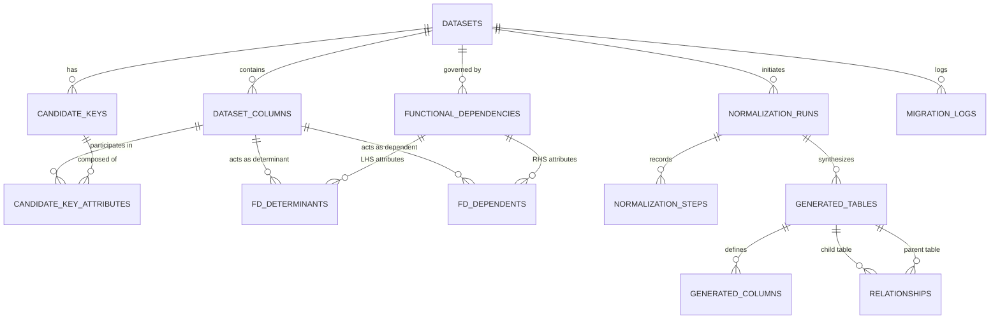

# SmartDB: Academic Database Design & Technical Specification

This document provides a comprehensive academic DBMS report and evaluation guide for **SmartDB – CSV/Excel Data Segregation and Normalization Application**.

---

## 1. Problem Statement & Objectives

### The Problem of Flat Spreadsheets
Organizations frequently store complex business data in flat CSV or Excel spreadsheets where records from multiple entities are combined into a single wide table (e.g., student details, department details, course information, and enrollments in one sheet). This causes major relational anomalies:
1. **Redundancy**: Repeating parent attributes (e.g., department head name repeated for every student in that department).
2. **Insertion Anomalies**: Inability to record a department before any student enrolls in it.
3. **Update Anomalies**: Changing a department head requires updating hundreds of rows; inconsistencies arise if any row is missed.
4. **Deletion Anomalies**: Deleting the last enrolled student accidentally erases all record of that department.

### Project Objectives
- **Automated Data Profiling**: Analyze scalar types, nullability, uniqueness, and attribute closures directly from tabular data.
- **Relational Dependency Mining**: Discover functional dependencies ($X \to Y$) and compute exact violation statistics.
- **Academic Normalization**: Synthesize 3NF relation schemas using Bernstein's Algorithm from a canonical minimal cover ($F_c$), mathematically proving **Lossless Join** and **Dependency Preservation**.
- **Dynamic MySQL Deployment**: Programmatically create normalized relational MySQL 8 tables with foreign keys arranged via topological sorting.
- **Live CRUD Operations**: Provide Create, Read, Update, and Delete operations on the generated tables while enforcing relational referential integrity.
- **Safe Resource Cleanup**: Support complete deletion of datasets, dropping dynamically generated physical databases and cascading metadata without affecting other datasets.

---

## 2. Architecture: Dual-Database Paradigm

SmartDB strictly separates the application's own relational metadata from the dynamically generated user databases:

```
+---------------------------------------------------------------------------------------+
|                                    MySQL 8 Server                                     |
+-------------------------------------------+-------------------------------------------+
|  1. SmartDB Application Catalog           |  2. Dynamically Generated User Databases   |
|     (smartdb_system)                      |                                           |
|                                           |  smartdb_ds_1                             |
|  - datasets                               |    - students (PK: student_id)            |
|  - dataset_columns                        |    - departments (PK: department_id)      |
|  - candidate_keys                         |    - enrollments (FK -> students, courses)|
|  - candidate_key_attributes               |                                           |
|  - functional_dependencies                |  smartdb_ds_2                             |
|  - fd_determinants                        |    - customers (PK: customer_id)          |
|  - fd_dependents                          |    - products (PK: product_id)            |
|  - normalization_runs                     |    - orders (FK -> customers)             |
|  - normalization_steps                    |    - order_items (FK -> orders, products) |
|  - generated_tables                       |                                           |
|  - generated_columns                      |                                           |
|  - relationships                          |                                           |
|  - migration_logs                         |                                           |
+-------------------------------------------+-------------------------------------------+
```

---

## 3. Entity-Relationship (ER) Model of `smartdb_system`

The application catalog itself is normalized up to **Third Normal Form (3NF)**. Non-atomic attributes (such as composite keys or dependency determinants) are modeled as distinct relational entities rather than JSON arrays.



---

## 4. Relational Schema & Data Dictionary

### Table 1: `datasets`
Master catalog tracking every uploaded flat spreadsheet.
- `id` INT AUTO_INCREMENT **[PK]**
- `dataset_code` VARCHAR(50) UNIQUE NOT NULL (System identifier, e.g. `DS_M1A2B3`)
- `original_name` VARCHAR(255) NOT NULL (User's uploaded file name)
- `stored_filename` VARCHAR(255) NOT NULL (Unique storage name on server)
- `file_type` ENUM('csv', 'xlsx', 'xls') NOT NULL
- `file_size_bytes` BIGINT NOT NULL
- `row_count` INT DEFAULT 0
- `column_count` INT DEFAULT 0
- `status` ENUM('uploaded', 'analyzed', 'normalized', 'migrated', 'error')
- `target_database` VARCHAR(100) NULL (Dynamic MySQL database name, e.g. `smartdb_ds_1`)
- `created_at` TIMESTAMP DEFAULT CURRENT_TIMESTAMP

### Table 2: `dataset_columns`
Stores metadata and scalar profiling metrics for each column in the unnormalized dataset.
- `id` INT AUTO_INCREMENT **[PK]**
- `dataset_id` INT NOT NULL **[FK -> datasets(id) ON DELETE CASCADE]**
- `column_index` INT NOT NULL
- `column_name` VARCHAR(100) NOT NULL
- `sanitized_name` VARCHAR(100) NOT NULL (Valid SQL identifier)
- `detected_type` VARCHAR(50) NOT NULL (Inferred MySQL storage type)
- `null_count` INT DEFAULT 0
- `unique_count` INT DEFAULT 0
- `sample_values` TEXT NULL

### Table 3: `candidate_keys`
Stores minimal candidate superkeys determined via Attribute Closure ($X^+ = R$).
- `id` INT AUTO_INCREMENT **[PK]**
- `dataset_id` INT NOT NULL **[FK -> datasets(id) ON DELETE CASCADE]**
- `key_name` VARCHAR(100) NOT NULL (e.g., `CK_1 (student_id, course_id)`)
- `is_selected_primary` BOOLEAN DEFAULT FALSE
- `created_at` TIMESTAMP DEFAULT CURRENT_TIMESTAMP

### Table 4: `candidate_key_attributes`
Junction table resolving composite candidate keys into 1NF/3NF atomic tuples.
- `candidate_key_id` INT NOT NULL **[FK -> candidate_keys(id) ON DELETE CASCADE]**
- `column_id` INT NOT NULL **[FK -> dataset_columns(id) ON DELETE CASCADE]**
- **Composite Primary Key**: (`candidate_key_id`, `column_id`)

### Table 5: `functional_dependencies`
Canonical functional dependency business rules discovered from data or confirmed by user.
- `id` INT AUTO_INCREMENT **[PK]**
- `dataset_id` INT NOT NULL **[FK -> datasets(id) ON DELETE CASCADE]**
- `determinism_ratio` DECIMAL(5, 4) DEFAULT 1.0000 (1.0 = 100% confidence)
- `violation_count` INT DEFAULT 0
- `violation_rate` DECIMAL(5, 2) DEFAULT 0.00
- `is_confirmed` BOOLEAN DEFAULT FALSE
- `dependency_type` ENUM('full', 'partial', 'transitive', 'candidate_key')
- `created_at` TIMESTAMP DEFAULT CURRENT_TIMESTAMP

### Table 6: `fd_determinants`
Left-Hand Side (LHS) attributes $X$ in functional dependency $X \to Y$.
- `fd_id` INT NOT NULL **[FK -> functional_dependencies(id) ON DELETE CASCADE]**
- `column_id` INT NOT NULL **[FK -> dataset_columns(id) ON DELETE CASCADE]**
- **Composite Primary Key**: (`fd_id`, `column_id`)

### Table 7: `fd_dependents`
Right-Hand Side (RHS) attributes $Y$ in functional dependency $X \to Y$.
- `fd_id` INT NOT NULL **[FK -> functional_dependencies(id) ON DELETE CASCADE]**
- `column_id` INT NOT NULL **[FK -> dataset_columns(id) ON DELETE CASCADE]**
- **Composite Primary Key**: (`fd_id`, `column_id`)

### Table 8: `normalization_runs`
Records normalization executions and academic verification scores.
- `id` INT AUTO_INCREMENT **[PK]**
- `dataset_id` INT NOT NULL **[FK -> datasets(id) ON DELETE CASCADE]**
- `target_database_name` VARCHAR(100) NOT NULL
- `normal_form_target` ENUM('1NF', '2NF', '3NF', 'BCNF') DEFAULT '3NF'
- `lossless_join_verified` BOOLEAN DEFAULT TRUE
- `dependency_preservation_score` DECIMAL(5, 2) DEFAULT 100.00
- `status` ENUM('draft', 'schema_generated', 'migrated', 'failed')
- `table_count` INT DEFAULT 0
- `created_at` TIMESTAMP DEFAULT CURRENT_TIMESTAMP
- `completed_at` TIMESTAMP NULL

### Table 9: `normalization_steps`
Academic audit log detailing 1NF, 2NF, and 3NF decomposition steps.
- `id` INT AUTO_INCREMENT **[PK]**
- `normalization_run_id` INT NOT NULL **[FK -> normalization_runs(id) ON DELETE CASCADE]**
- `stage` VARCHAR(50) NOT NULL (e.g. `MINIMAL_COVER`, `1NF`, `2NF`, `3NF`)
- `title` VARCHAR(150) NOT NULL
- `passed` BOOLEAN NOT NULL
- `explanation` TEXT NOT NULL

### Table 10: `generated_tables`
Catalog of synthesized physical tables in the target database.
- `id` INT AUTO_INCREMENT **[PK]**
- `normalization_run_id` INT NOT NULL **[FK -> normalization_runs(id) ON DELETE CASCADE]**
- `table_name` VARCHAR(100) NOT NULL
- `original_table_name` VARCHAR(100) NULL
- `row_count` INT DEFAULT 0
- `created_at` TIMESTAMP DEFAULT CURRENT_TIMESTAMP

### Table 11: `generated_columns`
Column schema definitions for each generated table.
- `id` INT AUTO_INCREMENT **[PK]**
- `generated_table_id` INT NOT NULL **[FK -> generated_tables(id) ON DELETE CASCADE]**
- `column_name` VARCHAR(100) NOT NULL
- `data_type` VARCHAR(50) NOT NULL
- `is_primary_key` BOOLEAN DEFAULT FALSE
- `is_foreign_key` BOOLEAN DEFAULT FALSE
- `is_nullable` BOOLEAN DEFAULT TRUE

### Table 12: `relationships`
Models foreign key associations between parent and child generated tables.
- `id` INT AUTO_INCREMENT **[PK]**
- `normalization_run_id` INT NOT NULL **[FK -> normalization_runs(id) ON DELETE CASCADE]**
- `parent_table_id` INT NOT NULL **[FK -> generated_tables(id) ON DELETE CASCADE]**
- `child_table_id` INT NOT NULL **[FK -> generated_tables(id) ON DELETE CASCADE]**
- `parent_column_name` VARCHAR(100) NOT NULL
- `child_column_name` VARCHAR(100) NOT NULL
- `relationship_type` ENUM('1:N', '1:1', 'N:M') DEFAULT '1:N'

### Table 13: `migration_logs`
Chronological execution audit trail for physical DDL and DML operations.
- `id` INT AUTO_INCREMENT **[PK]**
- `dataset_id` INT NOT NULL **[FK -> datasets(id) ON DELETE CASCADE]**
- `stage` VARCHAR(50) NOT NULL
- `status` ENUM('pending', 'in_progress', 'completed', 'error')
- `message` TEXT NOT NULL
- `sql_executed` TEXT NULL
- `created_at` TIMESTAMP DEFAULT CURRENT_TIMESTAMP

---

## 5. Normalization Proof for `smartdb_system`

### 1NF (First Normal Form)
- **Atomic Values**: In the revised schema, all columns store scalar atomic values. Multi-valued determinants and dependents are stored across discrete rows in junction tables (`fd_determinants`, `fd_dependents`), eliminating non-atomic JSON strings.
- **Unique Records**: Every entity possesses an explicit integer surrogate Primary Key (`id`), and junction tables enforce composite primary keys (e.g. `(fd_id, column_id)`).

### 2NF (Second Normal Form)
- Meets 1NF.
- **No Partial Dependencies**: For tables with composite primary keys (`candidate_key_attributes`, `fd_determinants`, `fd_dependents`), all non-key attributes are absent, or depend fully on the complete composite primary key.

### 3NF (Third Normal Form)
- Meets 2NF.
- **No Transitive Dependencies**: Non-key attributes depend only on the primary key, directly with no transitive chains ($X \to Y \to Z$ where $Y$ is non-key). For example, `generated_columns` references `generated_tables.id`, avoiding duplicate storage of table names or database names.

---

## 6. Dynamic MySQL Generation & Topological Sorting

When executing physical migration into MySQL 8:
1. **DAG Construction**: Tables form a Directed Acyclic Graph where an edge $P \to C$ signifies child table $C$ holds a Foreign Key referencing parent table $P$.
2. **Kahn's Algorithm**:
   - Compute in-degree for each table (number of parent tables it references).
   - Queue tables with in-degree 0 (independent tables, e.g. `departments`).
   - Process each table, decrement in-degree of referencing tables, and queue newly unconstrained tables (e.g. `students`, then `enrollments`).
3. **Execution**: DDL statements and data population run strictly in topological order to prevent MySQL `Error 1215: Cannot add foreign key constraint`.

---

## 7. Sample SQL Demonstration Queries

### Complex Join across Generated Normalized Tables
Reconstructing the original flat dataset from normalized 3NF tables without spurious tuples:
```sql
USE `smartdb_ds_1`;

SELECT 
    s.student_id,
    s.student_name,
    s.student_email,
    d.department_id,
    d.department_name,
    d.department_head,
    c.course_id,
    c.course_name,
    c.credits,
    e.semester,
    e.grade
FROM enrollments e
INNER JOIN students s ON e.student_id = s.student_id
INNER JOIN courses c ON e.course_id = c.course_id
INNER JOIN departments d ON s.department_id = d.department_id
ORDER BY s.student_id, c.course_id;
```

### Parameterized CRUD Operations on Generated Tables
- **Create (Insert Record)**:
```sql
INSERT INTO `students` (`student_id`, `student_name`, `student_email`, `department_id`) 
VALUES (?, ?, ?, ?);
```
- **Read (Filtered Search & Pagination)**:
```sql
SELECT * FROM `students` 
WHERE `student_name` LIKE ? OR `student_email` LIKE ? 
ORDER BY `student_id` ASC 
LIMIT 12 OFFSET 0;
```
- **Update (Modify Record by Primary Key)**:
```sql
UPDATE `students` 
SET `student_name` = ?, `student_email` = ? 
WHERE `student_id` = ?;
```
- **Delete (Referential Integrity Check)**:
```sql
-- Attempting deletion of a student who has records in enrollments:
DELETE FROM `students` WHERE `student_id` = ?;
-- MySQL enforces foreign key constraint:
-- ERROR 1451 (23000): Cannot delete or update a parent row: a foreign key constraint fails
```

### Safe Dataset Deletion (Lifecycle Cleanup)
```sql
-- 1. Identify target database name from metadata
SELECT target_database FROM `smartdb_system`.`datasets` WHERE id = 1;

-- 2. Drop the dynamic database safely
DROP DATABASE IF EXISTS `smartdb_ds_1`;

-- 3. Delete metadata record (Cascades automatically to all child tables)
DELETE FROM `smartdb_system`.`datasets` WHERE id = 1;
```
